# 基于SpringBoot与Vue的智能菜谱推荐平台的设计与实现

> 本文围绕智能菜谱推荐平台的开发全过程，详细阐述了基于SpringBoot、Vue、MySQL、Redis、Qdrant向量数据库及DeepSeek大模型技术构建的“今日食单”系统。该系统旨在解决用户日常饮食选择困难与个性化膳食需求难以满足的问题，通过小程序端与PC管理后台的协同，实现了从菜谱浏览到AI智能推荐、从内容创作到平台运营的完整闭环。

## 一、项目背景

随着人们生活水平的提高和健康意识的增强，越来越多的人开始关注日常饮食的营养搭配与多样化。然而，在快节奏的现代生活中，用户常常面临“不知道吃什么”的选择困难，同时，海量的网络菜谱信息质量参差不齐，缺乏个性化匹配。

本项目“今日食单”正是为解决上述痛点而设计。系统面向普通用户与平台管理员两类角色，构建了一个集菜谱展示、搜索、详情查看、AI智能推荐、用户互动与后台管理于一体的综合性智能菜谱推荐平台。该项目利用先进的向量数据库与大模型技术，对菜谱数据进行深度语义理解与个性化匹配，旨在为用户提供精准、便捷且富有创意的美食推荐服务。

## 二、功能模块介绍

本系统整体划分为两大客户端：面向普通消费者的小程序端和面向运营管理人员的 PC 管理后台端。

| 角色名称 | 所属端 |
| :--- | :--- |
| 用户 | 小程序 |
| 管理员 | PC后台 |

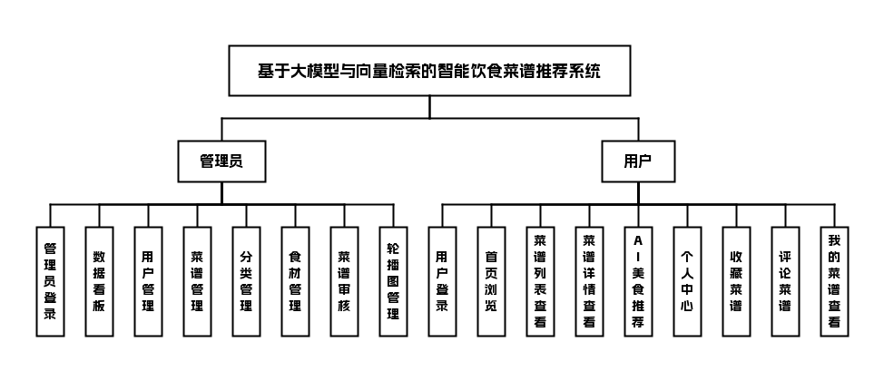

## 三、技术栈说明

前端：Vue + Element Plus、uni-app

后端：Java + SpringBoot

数据库与中间件：MySQL、Redis、Qdrant向量数据库

大模型与API：DeepSeek API

## 四、核心模块介绍

### 小程序端

#### 用户

| 功能模块 | 功能描述 |
| :--- | :--- |
| 首页 | 展示推荐菜品、轮播图及快捷入口，提供个性化内容分发 |
| 菜谱列表 | 浏览全部分类菜谱，支持关键词搜索与分类筛选 |
| 菜谱详情 | 展示菜品的食材、步骤、烹饪时间及用户评论，支持收藏与点赞 |
| AI美食推荐 | 基于DeepSeek大模型与向量检索技术，生成个性化推荐结果 |
| 用户登录 | 提供微信授权登录能力，完成用户身份注册与识别 |
| 个人中心 | 展示用户的基本信息、历史足迹与操作入口 |
| 我的收藏 | 集中管理用户收藏的菜谱列表，可快速取消收藏 |
| 我的评论 | 查看用户在菜谱详情下发布的历史评论记录 |
| 我的菜谱 | 允许用户进行个人菜谱的创建、编辑与发布操作 |

##### 界面展示

注册页：创建用户账号，注册后可收藏菜谱、发布评论

登录页：用户输入账号密码登录，享受个性化菜谱推荐

首页：展示推荐菜谱，为用户推荐合适美食

菜谱列表页：按条件筛选菜谱，展示对应菜谱列表

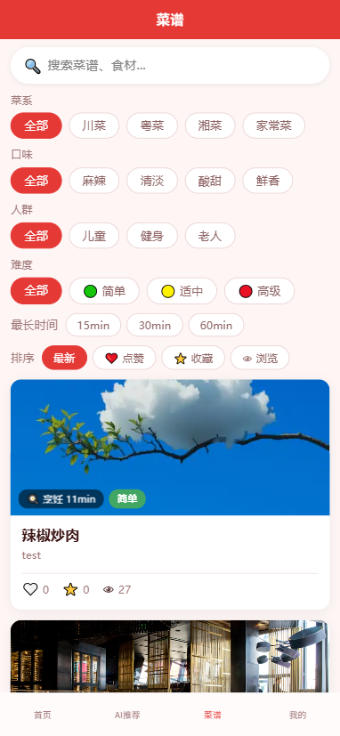

菜谱详情页：展示鸡胸肉沙拉菜谱的详细信息

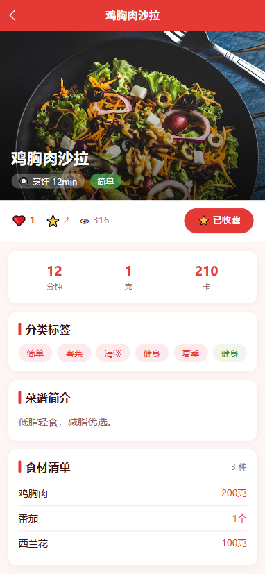

菜谱详情页：展示鸡胸肉沙拉的制作方法和相关小贴士

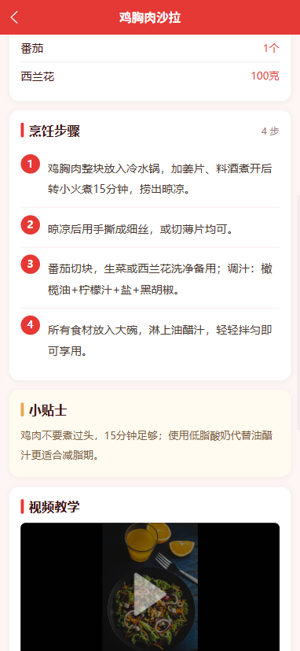

菜谱详情页：展示鸡胸肉沙拉菜谱下的用户评论

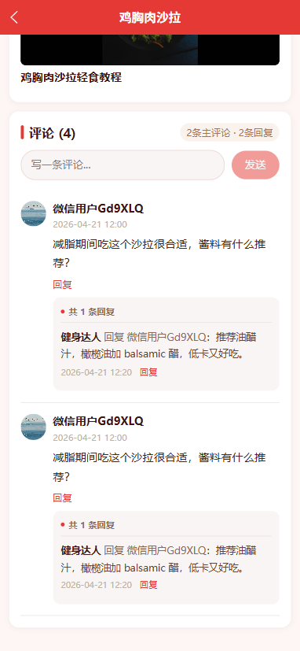

AI美食推荐页：根据用户饮食需求，推荐符合要求的菜品菜谱

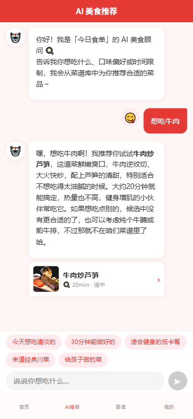

个人中心页：展示个人功能入口，可设置个人口味偏好

个人中心：修改用户个人信息，修改后可保存更新资料

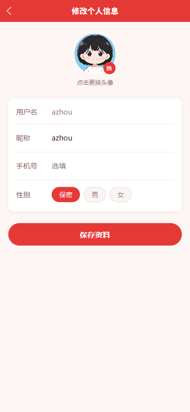

我的菜谱页：查看管理个人发布的菜谱，支持新增菜谱

新增菜谱页：填写菜谱信息，提交新增个人菜谱

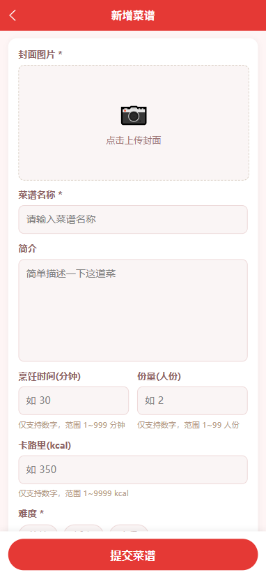

新增菜谱页：填写菜谱信息，提交新增个人菜谱

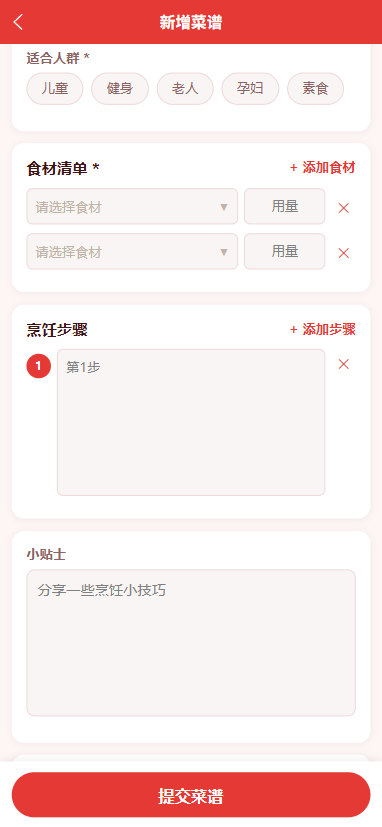

我的收藏页：展示用户收藏的菜谱，支持搜索收藏菜谱

我的评论页：展示用户本人发布在对应菜谱下的评论

### PC后台端

#### 管理员

| 功能模块 | 功能描述 |
| :--- | :--- |
| 管理员登录 | 验证管理员身份，保障后台数据操作的安全性与权限隔离 |
| 数据看板 | 展示平台核心运营数据，如用户总数、菜品数量、审核状态等 |
| 用户管理 | 查看、检索、禁用或启用平台注册用户账号 |
| 菜谱管理 | 对平台全部菜谱进行查询、编辑、上下架或删除操作 |
| 分类管理 | 维护菜谱的分类信息，支持新增、修改、排序与停用 |
| 食材管理 | 维护食材库，支持对食材信息的增删改查及关联菜谱管理 |
| 菜谱审核 | 审核用户提交的“我的菜谱”，控制内容质量与合规性 |
| 轮播图管理 | 维护小程序首页轮播图内容，支持图片更新与跳转链接配置 |

##### 界面展示

登录页：输入信息验证身份，登录今日食单管理后台

数据看板：展示平台菜谱统计数据与热门菜谱相关信息

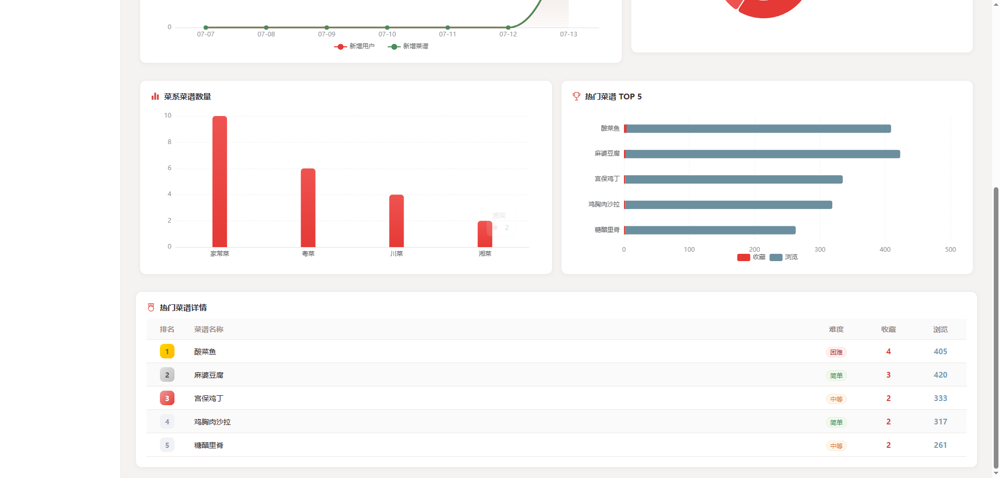

数据看板：展示今日食单平台运营数据的统计概览

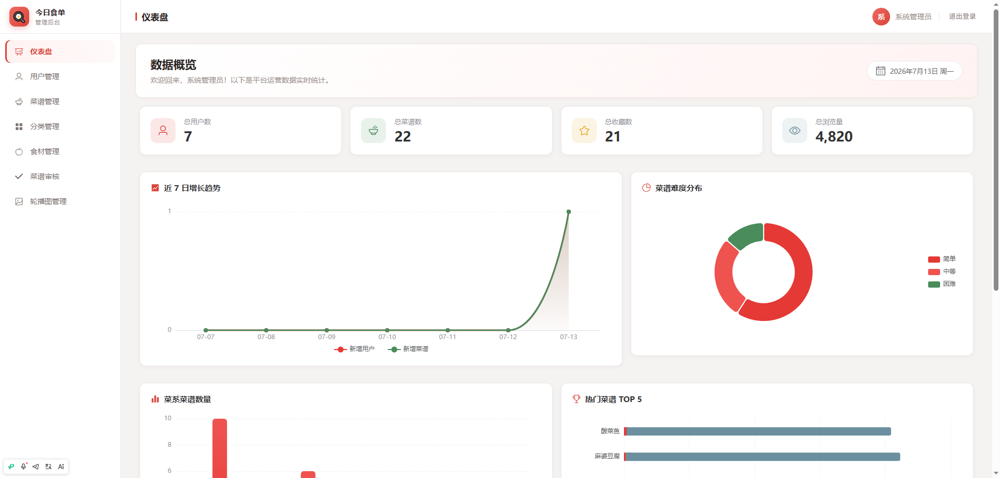

用户管理页：查看平台用户信息，可查询禁用用户账号

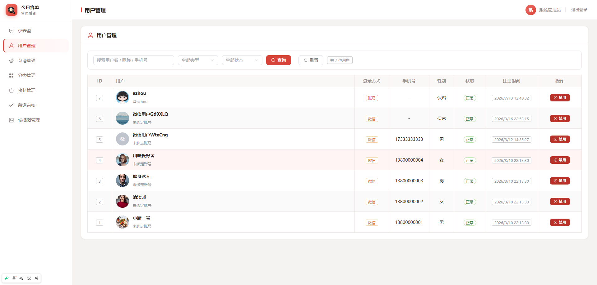

菜谱管理页：展示菜谱列表，支持对菜谱做增删改查操作

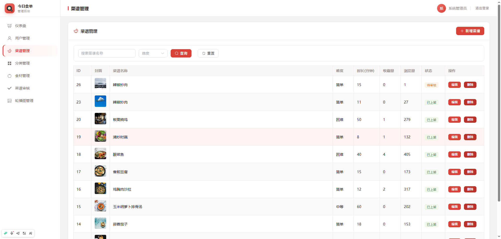

菜谱管理：编辑菜谱的基础信息与制作步骤

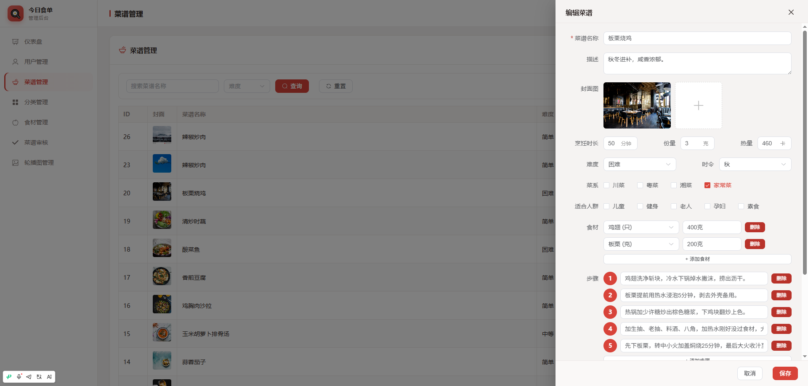

菜谱审核页：统计各状态菜谱数量，审核待审核菜谱

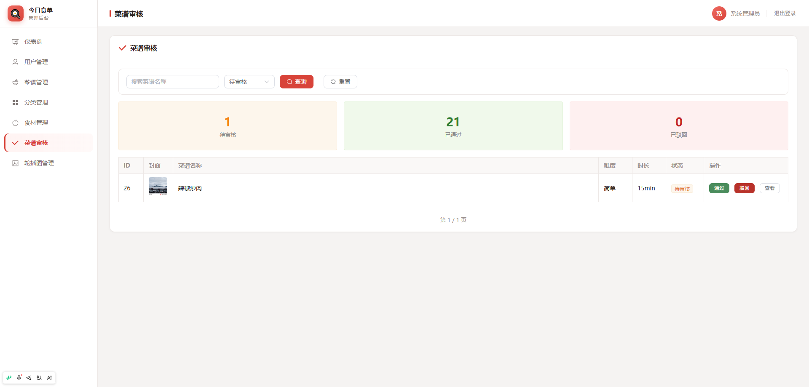

分类管理页：管理菜谱各类分类，支持增删改操作

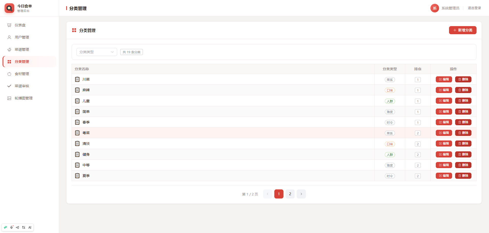

食材管理：管理员对平台食材进行查询、增删改管理

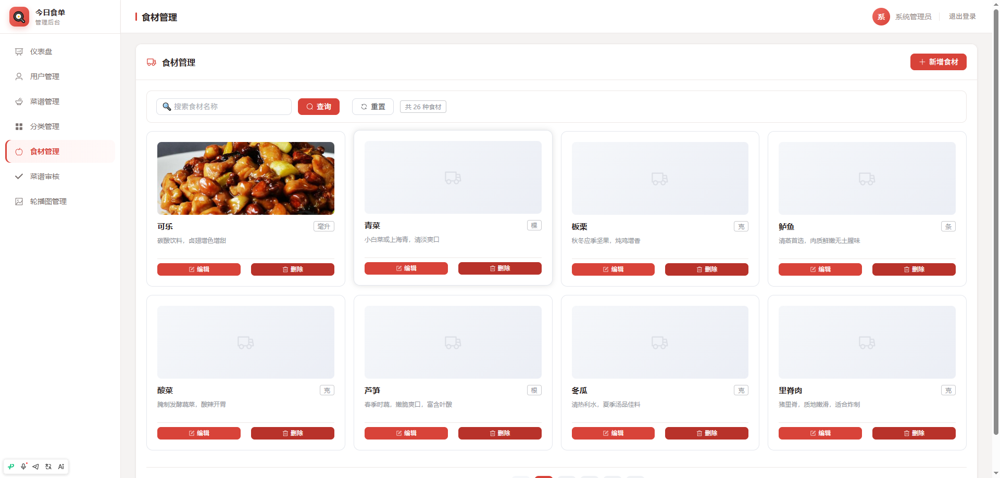

轮播图管理页：管理平台轮播图，支持新增、编辑、删除操作

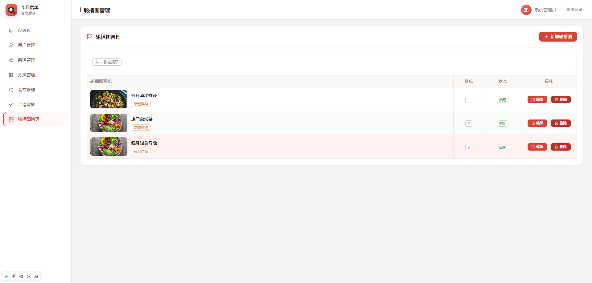

## 五、主要业务流程

1. 管理员通过PC后台输入账号密码进行登录，系统校验身份并进入数据看板。

2. 管理员在“分类管理”中维护菜品分类，在“食材管理”中维护基础食材数据。

3. 用户在微信小程序端进行授权登录，系统获取用户身份并创建或更新本地账号信息。

4. 用户在小程序首页浏览轮播图及推荐内容，或进入菜谱列表进行搜索与筛选。

5. 用户点击菜谱卡片进入菜谱详情页，查看食材、步骤和评论信息，可进行收藏或发表评论。

6. 用户在“AI美食推荐”模块输入偏好或需求，后端调用DeepSeek API并通过向量数据库检索相关菜谱。

7. 用户可在“我的菜谱”中提交自创菜谱，该菜谱进入后台待审核状态。

8. 管理在后台“菜谱审核”模块对待审核菜谱进行内容检查，通过后该菜谱正式上线展示。

9. 管理员通过“数据看板”监控平台用户增长、内容发布趋势，持续优化平台运营策略。

## 六、项目拓展性

本项目在架构设计与技术选型上具备良好的前瞻性与扩展能力，未来可在多个维度进行拓展。在智能推荐方面，可引入用户行为序列分析与实时兴趣图谱，进一步提升推荐精度；在内容生态方面，可增加视频菜谱制作与分享功能，丰富内容表现形式；在社交属性方面，可增加用户关注、话题挑战及互动社区，增强用户粘性；在商业模式方面，可拓展电商模块，实现食材一键购买与半成品配送服务。此外，系统可向多端延伸，未来可开发Web端或桌面端，构建全渠道覆盖的数字化饮食服务平台。

## 代码说明 
本仓库为项目的 **后端核心代码部分** 主要用于展示系统的业务设计思路与后端实现方式 出于学习展示与版权保护考虑 前端实现、完整数据库脚本及部署配置未在本仓库中公开 

##  项目交流 
本项目用于学习展示 如需项目完整功能演示、答辩说明或技术交流 请前往作者 GitHub 主页查看联系方式